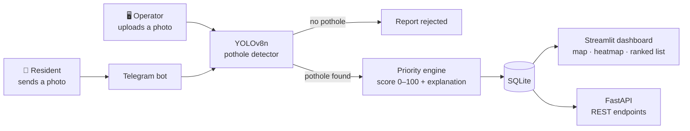

# 🚧 RoadSense AI: Road Defect Monitoring for Almaty

**Residents report potholes through a Telegram bot. A YOLOv8 model checks each photo, and a city dashboard ranks confirmed reports by repair priority, with a plain-language reason for every score.**

[](https://roadsense-ai-shfh8ssrifzngffcamzqpd.streamlit.app/)
[](https://github.com/XteteX/roadsense-ai/actions/workflows/ci.yml)


Built in 10 days at **Decentrathon 5.0**, where the team placed in the **Top 5**.

---

## 🎯 Problem

City road services in Almaty handle pothole complaints one at a time: a call or a message, a manual check, a repair. There is no shared map of where defects cluster and no consistent way to decide which hole to fix first. RoadSense AI turns scattered citizen reports into a single, prioritised map.

## 🌐 Live demo

**[▶ Open the RoadSense AI dashboard](https://roadsense-ai-shfh8ssrifzngffcamzqpd.streamlit.app/)**

The map is pre-filled with **synthetic sample data** (`data/defects.json`), so you can try the heatmap, filters and explanations right away. You can also upload your own road photo in the sidebar to run the detector. Streamlit Community Cloud puts idle apps to sleep, so the first load may take up to a minute.

---

## ⚙️ How it works



1. **Report.** A resident sends a photo to the Telegram bot (or an operator uploads one on the dashboard).
2. **Verify.** A YOLOv8n model checks the photo. Photos without a pothole are rejected, which filters out spam and mistakes.
3. **Prioritise.** A transparent rule-based engine scores the defect from 0 to 100 and writes a one-sentence explanation.
4. **Act.** The dashboard shows every report on a map with a density heatmap and a list sorted by priority, so crews can start from the top.

---

## 🧠 How priority is calculated

The rules in [`src/engine.py`](src/engine.py) are written by hand. There is no trained model behind them, so every score can be traced back to its inputs.

```
score = type_weight × size_cm × (1 + 0.4 × (traffic_level − 1)) + social_bonus      (capped at 100)
```

| Term | Values |
|---|---|
| `type_weight` | pothole 1.5 · rutting 1.1 · crack 0.7 · faded marking 0.4 |
| `traffic_level` | 1 (low) · 2 (medium) · 3 (high) |
| `social_bonus` | +15 if a school or hospital is nearby, otherwise 0 |

| Score | Category |
|---|---|
| ≥ 80 | 🔴 Critical |
| 50–79 | 🟠 High |
| 25–49 | 🔵 Medium |
| < 25 | 🟢 Low (planned) |

**Example.** A 30 cm pothole on a medium-traffic road near a school scores 1.5 × 30 × 1.4 + 15 = **78.0 (High)**, and the dashboard explains:

> *Priority 78.0/100 is driven by: large pothole (30.0 cm), moderate traffic load, close to a school or hospital, high risk of suspension damage and loss of control.*

The detector only finds **potholes**. Cracks, rutting and faded markings appear in the synthetic sample data to show how scoring and the map would work with more defect types.

---

## ✅ Project status

| Component | Status | What it does now |
|---|---|---|
| Pothole detection | ✅ Working | Pre-trained open-source YOLOv8n model (`pothole_best.pt`, one class: *pothole*) |
| Telegram bot | ✅ Working | Accepts photos, rejects ones without a pothole, saves confirmed reports, ignores duplicate deliveries. Replies in Russian, or in English for English-language Telegram users |
| Priority engine | ✅ Working | 0–100 score, category and text explanation for every report |
| Dashboard | ✅ Working | KPIs, map with markers, priority-weighted heatmap, category filter, ranked list with explanations, photo upload with live detection |
| REST API | ✅ Working | `GET /defects`, `GET /defects/{id}`, `POST /priority`, `POST /detect` (FastAPI, docs at `/docs`) |
| Database | ✅ Working | SQLite stores reports and the bot's processed-message log |
| Tests and CI | ✅ Working | Unit tests for the engine, database and API run on every push (GitHub Actions) |
| Defect size | ⚠️ Simulated | Estimated from the bounding-box area plus a random offset, not measured |
| Location | ⚠️ Simulated | Derived from where the pothole appears in the image, offset from Almaty's centre; no GPS yet |
| Traffic and nearby schools/hospitals | ⚠️ Manual | Set on the dashboard form; the bot uses fixed defaults |

---

## 🛠 Tech stack

| Module | Technology |
|---|---|
| Detection | Ultralytics YOLOv8n, OpenCV, Pillow |
| Bot | pyTelegramBotAPI |
| Dashboard | Streamlit, Folium (Leaflet), streamlit-folium |
| API | FastAPI, Pydantic |
| Storage | SQLite |
| Quality | pytest, GitHub Actions |

---

## 🚀 Quick start

Requires Python 3.11 (see `runtime.txt`).

```bash
git clone https://github.com/XteteX/roadsense-ai.git
cd roadsense-ai
python -m venv .venv
source .venv/bin/activate          # Windows: .venv\Scripts\activate
pip install -r requirements.txt
```

**Dashboard**

```bash
streamlit run src/dashboard.py
```

**Telegram bot.** Create a bot with [@BotFather](https://t.me/BotFather), then:

```bash
export TELEGRAM_BOT_TOKEN="your-token"     # PowerShell: $env:TELEGRAM_BOT_TOKEN="your-token"
python -m src.bot
```

**REST API**

```bash
uvicorn src.main:app --reload             # interactive docs: http://127.0.0.1:8000/docs
curl -X POST http://127.0.0.1:8000/priority -H "Content-Type: application/json" \
     -d '{"type": "pothole", "size_cm": 30, "traffic_level": 2, "is_near_social": true}'
```

**Detector on a single photo**

```bash
python -m src.detection path/to/road.jpg  # saves path/to/road_detected.jpg with boxes
```

**Other commands**

```bash
python src/utils.py                       # regenerate 50 synthetic defects in data/defects.json
python -m src.migrate                     # import data/defects.json into SQLite
pytest                                    # run the tests
```

---

## 📂 Project structure

```
roadsense-ai/
├── src/
│   ├── bot.py           # Telegram bot: photo intake, verification, saving reports
│   ├── dashboard.py     # Streamlit dashboard: KPIs, map, heatmap, ranked list, photo upload
│   ├── detection.py     # YOLOv8 inference and bounding-box drawing
│   ├── engine.py        # priority scoring and explanations
│   ├── database.py      # SQLite access (path independent of the working directory)
│   ├── main.py          # FastAPI REST API
│   ├── utils.py         # synthetic sample-data generator
│   └── migrate.py       # imports data/defects.json into SQLite
├── tests/               # pytest: engine, database, API
├── data/
│   ├── defects.json     # synthetic sample defects
│   └── roadsense.db     # SQLite database used by the demo
├── pothole_best.pt      # pre-trained YOLOv8n pothole weights (6 MB)
├── .streamlit/          # Streamlit config
├── .github/workflows/   # CI
├── requirements.txt
└── runtime.txt
```

---

## ⚠️ Known limitations

- **The detector was not trained by our team** and has not been evaluated on Almaty roads, so its accuracy here is unknown.
- In our tests it missed potholes in photos taken after rain, when the holes were filled with muddy water.
- Location and size are approximations (see Project status), not measurements.
- The bot uses fixed traffic and "near a school/hospital" values for every report.
- Any Telegram user can submit photos; there is no protection against manipulated or misleading images.
- The economic-impact figure on the dashboard is an illustrative estimate (45,000 ₸ per defect fixed early), not official city data.

## 🛣️ Roadmap

- [ ] Read real GPS from Telegram location messages or photo EXIF data
- [ ] Collect and label local photos (rain, mud, snow, night) and fine-tune the detector on them
- [ ] Measure mAP on a held-out set of Almaty photos
- [ ] Look up traffic and nearby schools/hospitals from OpenStreetMap instead of fixed values
- [ ] Merge duplicate reports of the same pothole
- [ ] Generate PDF work orders for repair crews
- [ ] Move the bot and dashboard onto the shared FastAPI backend

---

## 👥 Team

- **Marlen Oryntay**: team lead; AI integration, backend, Telegram bot, priority engine
- **Amirzhan Dauletov**: frontend, dashboard UX, presentation

## 🙏 Acknowledgements

The pothole detection weights (`pothole_best.pt`) are a pre-trained, open-source YOLOv8n model (trained in August 2023 with Ultralytics 8.0.164, single class *pothole*). They were not trained by our team. Detection runs on [Ultralytics YOLOv8](https://github.com/ultralytics/ultralytics); maps use [Folium](https://python-visualization.github.io/folium/) and OpenStreetMap tiles.

## 📄 License

Developed for the Decentrathon 5.0 hackathon. All rights reserved.
